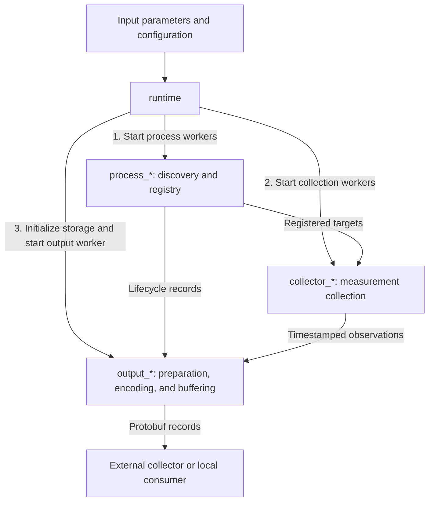

# rdk-observer-rs

`rdk-observer-rs` is a system process observer for RDK devices. Its goal is to discover processes, collect resource measurements, and prepare Protobuf records for an external collector or local processing consumer.

This repository is currently a project scaffold. The source modules document the intended design; the workers, command-line entry point, and delivery mechanisms are not implemented yet.

## Planned tracking options

The observer will support the following process selection options:

- All user-space processes.
- Kernel processes, where the system exposes them through `/proc`.
- User-space processes associated with RDK-B.
- Individually selected processes.

These options will allow deployments to choose between broad process monitoring and a selected subset. Monitoring individual threads within a process is outside the initial scope; system-wide resource totals will provide overall device context.

## Program design

The program separates target management, measurement collection, and output handling:

| Modules | Responsibility |
| --- | --- |
| `process_*` | Discover candidate processes, select targets, and maintain the process registry. |
| `collector_*` | Collect measurements for registered targets or system totals. |
| `output_*` | Prepare observations, encode Protobuf, buffer records, and route them to a consumer. |
| `config` | Represent input options, including target selection, resources, sampling, and output destination. |
| `runtime` | Start and connect the required Tokio workers and manage their lifecycle. |

The planned entry point will read input parameters, build and validate configuration, and launch `runtime`. Configuration will determine which processes and resources to monitor, the collection scope, and whether records go to an external or local consumer.

### Process targets

`process_discovery` will find candidate targets through full `/proc` scans and process lifecycle events. An initial scan will discover already-running processes, while fork, exec, and exit events will keep tracking current. Event listeners will be attached before the startup scan, and periodic reconciliation scans will recover from missed events.

`process_worker` will apply selection rules, update `process_registry`, and coordinate collection for the selected targets. The registry will identify each process by PID and start time so PID reuse does not attach an old process's history to a new one. The coordinator will start and stop per-process collection tasks, combine repeated collection requests, and send lifecycle records to the output worker.

ADR-0003 defines the BPF event path: kernel tracepoints, BPF programs loaded with Aya, and a BPF ring buffer read by the observer. Netlink is a possible alternative event source whose integration remains to be defined.

### Measurement collection

`collector_worker` tasks will use the registered targets and enabled resource collectors. Configuration will select collection for an individual process, a full pass over the selected process list, system totals, or a combination.

Resource modules such as `collector_cpu`, `collector_memory`, and `collector_io` will provide collection functions. For example, the CPU collector will support system counters from `/proc/stat` and per-PID counters from `/proc/<pid>/stat`. Per-process memory and I/O fields still need to be defined. Network and pressure collection are planned extensions; per-process measurements will require sources that support that attribution, and unavailable measurements will remain distinguishable from zero.

Per-process tasks will use adaptive sampling intervals, bounded jitter, and a shared read concurrency limit. Full-list requests will be coordinated with active tasks to avoid duplicate reads. System totals will be sampled independently when requested.

Collectors will send timestamped observations directly to `output_worker` through channels. A discovery scan identifies targets; a collection pass reads their measurements. A full process snapshot is a pass over the selected targets, not an atomic view of every process or the whole system.

### Output handling

`output_worker` will receive resource observations and lifecycle records, preserving timestamps, process identities, raw values, units, and unavailable measurements. When configured, it will derive CPU utilization and I/O rates from consecutive valid samples. First samples establish baselines; counter resets or identity changes invalidate affected deltas.

`output_model` will expose message types generated from shared Protobuf schemas, and `output_encoding` will encode and decode records using `prost`. `output_storage` will hold encoded records in a planned in-memory ring buffer capped at 500 KB (500,000 bytes), including buffer bookkeeping.

The output worker will route buffered Protobuf records to the configured external collector or local processing consumer. Both will use the same schema. The transport, local consumer interface, batching, retry behavior, buffer overflow policy, channel backpressure, and pending-record handling during shutdown remain to be defined.

### Runtime coordination

`runtime` will launch the workers required by configuration, connect their channels, provide shared concurrency limits, monitor failures, and manage shutdown. `process_worker` will coordinate collection for registered process targets, while `runtime` will start independent system collection when totals are requested.

Startup will follow this order for the enabled workers:

1. `process_*`: start discovery and target coordination, and establish the process registry.
2. `collector_*`: start collection tasks for the registered targets and any requested system totals.
3. `output_*`: initialize output storage and start the worker that prepares, buffers, and delivers Protobuf records.

Collection tasks will wait until the output worker is ready before producing observations. Lifecycle record delivery will also wait for output readiness, while process discovery continues tracking targets.

## Architecture decisions

- [ADR-0001: Collect System Resource Snapshots from procfs](docs/architecture/adr/0001-collect-system-resource-snapshots-from-procfs.md)
- [ADR-0002: Schedule Per-Process Sampling Workers](docs/architecture/adr/0002-schedule-per-process-sampling-workers.md)
- [ADR-0003: Trigger Process Capture with Aya and BPF Events](docs/architecture/adr/0003-trigger-process-capture-with-bpf-events.md)
- [ADR-0004: Observation Record Format Decision (Protobuf)](docs/architecture/adr/0004-observation-record-format-decision.md)
