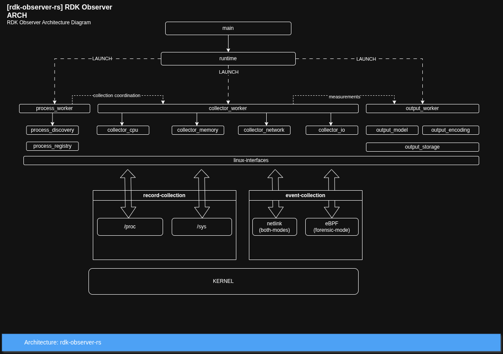
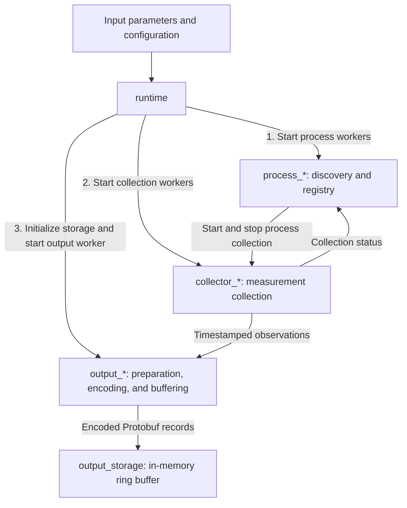
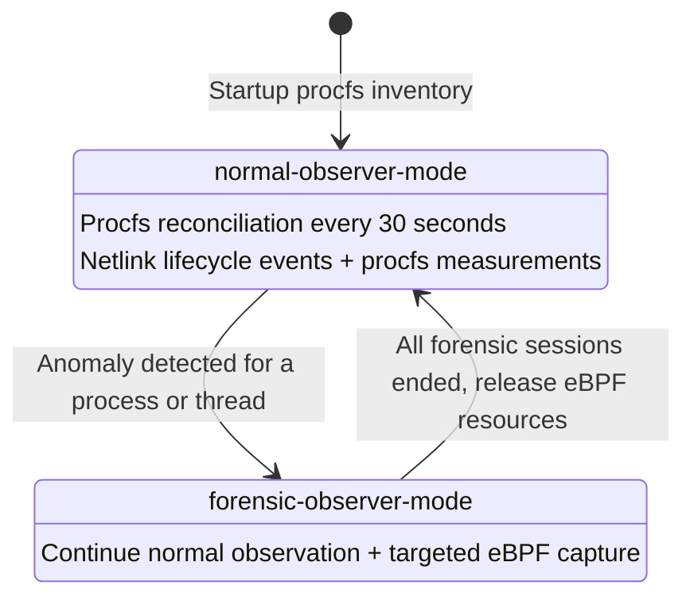
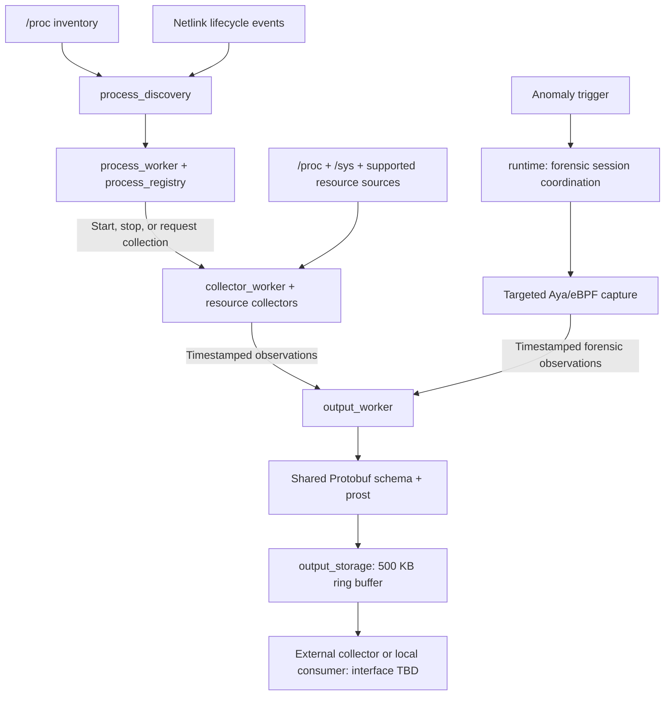

# rdk-observer-rs

`rdk-observer-rs` is a system process observer for RDK devices. Its goal is to discover processes, collect resource measurements, and prepare Protobuf records for an external collector or local processing consumer.

This repository is currently a project scaffold. The executable entry point exists; the source modules document the intended design, while the workers and delivery mechanisms are not implemented yet.

## Problem solved

RDK-Observer is intended to provide continuous, low-overhead observability of CPU, DRAM, processes, network, and I/O activity across an RDK device.

On a resource-constrained device, the goal is to understand **where the available resources are going** and which processes or kernel activities consume them. Combining system metrics, process-level information, and Linux observability mechanisms will help track resource use over time, correlate transient events with their likely cause, evaluate the efficiency of current components, and support future architectural decisions.

Tools such as `top` and `htop` provide an immediate view of resource use. RDK-Observer will collect timestamped observations continuously and prepare compact telemetry for long-term analysis, allowing consumers to identify gradual memory growth, recurring load patterns, intermittent peaks, and changes in process behavior.

Periodic sampling can miss processes that start and exit between snapshots. Netlink lifecycle notifications will complement procfs snapshots during normal observation, while targeted Aya/eBPF capture will add detail after anomaly detection. Event loss or unavailable netlink support can still leave short-lived processes undiscovered.

## Running the scaffold

```sh
cargo run --bin rdk-observer
```

[`main.rs`](rdk-observer/src/main.rs) calls the library's `runtime::run()` function. It returns exit code 0 on success, or prints the runtime error to standard error and returns exit code 1 on failure. The runtime currently returns an explicit error stating that the observer workers are not implemented, so running the scaffold exits with code 1 and starts no monitoring.

The `rdk-observer/` directory contains the executable entry point and the nested `rdk-observer-core/` library crate. All other Rust source files live in `rdk-observer-core/src/`.

Argument parsing, configuration loading, and logging initialization will be added to `main.rs` when their interfaces are defined. Worker orchestration, observer mode transitions, and shutdown belong in `runtime.rs`.

## Planned tracking options

The observer will support the following process selection options:

- All user-space processes.
- Kernel processes, where the system exposes them through `/proc`.
- User-space processes associated with RDK-B.
- Individually selected processes.

These options will allow deployments to choose between broad process monitoring and a selected subset. Normal observation will track processes; forensic observation may target individual threads within an anomalous process. System-wide resource totals will provide overall device context.

## Functional requirements

The following requirements describe planned functionality. Field definitions, supported sources, anomaly rules, and implementation stages still need to be specified where noted in the architecture below.

Resource monitors must attribute observations to the stable process identity (`PID + start_time`) whenever the kernel exposes reliable per-process data. System-wide metrics must provide device context. Metrics that cannot be attributed reliably to an individual process must remain identified as system-wide observations. Unavailable measurements must remain distinguishable from zero.

### Process registry

- Track running processes and their lifecycle.
- Maintain stable identity using PID and start time.
- Collect metadata such as name, executable, parent PID, and command line.
- Keep current and recent historical process information, with retention bounded by the memory budget.
- Track start time, end time, and current state when known.
- Provide a shared process registry to the collection workers.
- Minimize discovery overhead.

### CPU resource management

- Monitor overall CPU utilization and CPU usage per process.
- Measure load and CPU pressure.
- Track user and system CPU time, context switches, and CPU migrations where available.
- Collect relevant perf/PMU counters where supported and enabled by the capture policy.
- Detect short CPU peaks and unusual CPU activity within the limits of the configured sampling and capture policy.

### DRAM resource management

- Monitor total, available, and used DRAM.
- Track per-process RSS, PSS, private memory, shared memory, and swap usage.
- Monitor page cache and kernel slab usage.
- Track memory pressure using PSI.
- Monitor page faults, reclaim, swap, and other memory activity where exposed.
- Detect memory growth, peaks, and potential out-of-memory conditions.

### Storage resource monitor

- Monitor system storage read/write activity and per-process I/O.
- Track bytes read and written, read and write operations, throughput, and latency where available.
- Track I/O pressure using PSI.
- Detect processes generating unusually high storage activity.

### Network resource monitor

- Monitor traffic per network interface and per-process network use where reliable attribution is available.
- Track RX/TX bytes and packets, packet drops, and errors.
- Track interface state and link changes.
- Collect relevant network-stack statistics.
- Detect unusual traffic or network resource consumption.

Network and pressure collection remain planned extensions. Sources requiring eBPF must follow the forensic activation policy; they must not introduce routine eBPF attachment in normal mode.

### Aggregation and metrics management

- Receive observations from the enabled collection workers.
- Correlate CPU, DRAM, network, and I/O information with validated process identities.
- Maintain bounded short-term history.
- Calculate configured averages, peaks, deltas, rates, and trends.
- Reduce high-frequency samples into compact telemetry where configured.
- Allow collection frequency and export frequency to be configured independently.
- Track the observer's own CPU, memory, storage, and collection overhead.

These requirements do not introduce a separate central Metric Collector Worker. Collection tasks will calculate configured CPU utilization and I/O rates; `output_worker` will prepare records. Ownership and retention policies for additional historical aggregation, averages, peaks, and trends remain to be defined within the resource budget. Export scheduling belongs to the consuming or delivery component, whose interface is still open.

### External collector and analysis

The intended external consumer will collect and store observations, provide dashboards and initial analysis, and potentially supply data to an AI model for deeper analysis. These downstream functions are separate from the observer's measurement collection, encoding, and buffering responsibilities. A local processing consumer may also use the same Protobuf records.

## Deliverables

The component should have measurable storage, CPU, and DRAM limits and support portability across RDK-B platforms.

### Initial resource targets

The initial targets under normal operation are approximately:

| Resource | Target |
| --- | --- |
| Storage footprint | At most 5 MB |
| DRAM usage | At most 10 MB |
| CPU utilization | Below 5% |

Deployment is intended to use a dedicated **cgroup** so resource usage can be measured and limits enforced where appropriate. These are design targets to validate on target devices. CPU accounting conventions, workload, and platform-specific acceptance criteria remain to be defined. Forensic capture will need explicit duration and resource limits.

The planned 500 KB output ring buffer, including its bookkeeping, is part of the overall DRAM budget.

## Architecture

The target architecture is a single Rust process built around the Tokio asynchronous runtime. Tokio tasks and `mpsc` channels will separate process discovery, collection, and output handling while keeping monitoring overhead suitable for a resource-constrained RDK gateway.



The program separates target management, measurement collection, and output handling:

| Modules | Responsibility |
| --- | --- |
| `process_*` | Discover candidate processes, select targets, maintain the process registry, and coordinate process collection. |
| `collector_*` | Collect measurements for registered targets or system totals, calculate configured derived values, and report collection status. |
| `output_*` | Prepare observation records, encode Protobuf, and store encoded records in the output buffer. |
| `config` | Represent input options, including target selection, resources, sampling, forensic capture policy, and record preparation. |
| `runtime` | Start and connect the required Tokio workers, manage their lifecycle, and coordinate observer mode transitions. |

The entry point will eventually read input parameters, build and validate configuration, and launch the configured `runtime`. Configuration will determine which processes and resources to monitor, the collection scope, and which raw and derived measurements to include in records.



### Observer modes

The observer will start in `normal-observer-mode`. It will discover existing processes with an initial `/proc` inventory snapshot, reconcile that inventory every 30 seconds, and use the Linux netlink process connector (`NETLINK_CONNECTOR` / `CN_PROC`) for fork, exec, and exit notifications between scans. Normal mode will collect procfs resource measurements without loading or attaching eBPF programs. Netlink will be the normal lifecycle event source.

When an anomaly is detected, `forensic-observer-mode` will add eBPF monitoring for the affected processes or threads. Aya will load and attach the required programs for the forensic session. Normal discovery, reconciliation, and procfs collection will continue during forensic capture. When all forensic sessions end, their eBPF resources will be released and the observer will return to normal mode. Anomaly rules, capture probes, duration, and resource limits remain to be defined.



### Process targets

`process_discovery` will subscribe to netlink lifecycle notifications before the startup inventory scan when the connector is available. It will forward scan results and events to `process_worker`, which will deduplicate them by process identity. Reconciliation every 30 seconds will discover missed processes and remove confirmed stale entries. Inventory scans identify targets; their cadence is independent of resource sampling intervals.

`process_worker` will apply selection rules, update `process_registry`, and coordinate collection for the selected targets. The registry will identify each process by PID and start time so PID reuse does not attach an old process's history to a new one. The coordinator will use process lifecycle events to start and stop per-process collection tasks and combine repeated collection requests. Collection tasks will report completion, target disappearance, and failures to the coordinator so it can reconcile collection state with the registry.

Netlink events include thread identifiers and thread-group identifiers, so a thread exit must not be treated as the exit of the whole process. Delayed events must not remove a newer process that reused a PID. If netlink is unavailable or loses events, discovery will continue through procfs reconciliation and report reduced lifecycle coverage; eBPF will remain reserved for anomaly-triggered forensics. Short-lived processes may be missed when events are unavailable or lost. [ADR-0003](docs/architecture/adr/0003-trigger-process-capture-with-bpf-events.md) defines discovery, recovery, and forensic mode boundaries.

### Snapshot sources

The planned snapshot path will read Linux information exposed through `/proc` and `/sys`. The `procfs` crate will provide access to process and system resource data. Typical sources include:

| Source | Intended measurements |
| --- | --- |
| `/proc/stat` | System CPU counters |
| `/proc/meminfo` | System DRAM, cache, and slab information |
| `/proc/diskstats` | System storage activity |
| `/proc/pressure/*` | CPU, memory, and I/O pressure |
| `/proc/<pid>/stat` | Process identity, CPU counters, and page faults |
| `/proc/<pid>/status` | Process status and memory information |
| `/proc/<pid>/smaps_rollup` | PSS and detailed memory accounting where available |
| `/proc/<pid>/io` | Per-process I/O counters |

`/sys` will complement procfs with network interface and device statistics, hardware information, thermal information, and platform-specific attributes where relevant. Network collection may also use netlink and kernel network statistics. Interface-level observations remain system-wide unless a source supports reliable process attribution.

### Measurement collection

`collector_worker` tasks will use the registered targets and enabled resource collectors. They will receive start and stop instructions from `process_worker` and report collection status back to it. Configuration will select collection for an individual process, a full pass over the selected process list, system totals, or a combination. `runtime` will coordinate independent system collection.

Resource modules such as `collector_cpu`, `collector_memory`, and `collector_io` will provide collection functions. For example, the CPU collector will support system counters from `/proc/stat` and per-PID counters from `/proc/<pid>/stat`. Per-process memory and I/O fields still need to be defined. Network and pressure collection are planned extensions; per-process measurements will require sources that support that attribution, and unavailable measurements will remain distinguishable from zero.

Per-process tasks will use adaptive sampling intervals, bounded jitter, and a shared read concurrency limit. Full-list requests will be coordinated with active tasks to avoid duplicate reads. System totals will be sampled independently when requested.

When configured, collection tasks will derive CPU utilization and I/O rates from consecutive valid samples. First samples establish baselines; counter resets or identity changes invalidate affected deltas. Collectors will send timestamped observations directly to `output_worker` through channels. A discovery scan identifies targets; a collection pass reads their measurements. A full process snapshot is a pass over the selected targets, not an atomic view of every process or the whole system.

### Sampling strategy

Sampling will use two complementary paths:

1. **System resource snapshots** will collect device-wide state from sources such as `/proc/stat`, `/proc/meminfo`, `/proc/diskstats`, PSI, and `/sys` at an independently configurable frequency.
2. **Per-process sampling** will read only the relevant `/proc/<pid>/...` files for each selected process. Targeted reads may run more frequently than system collection or discovery scans. Every observation will carry its own timestamp and validated process identity where applicable.

The original sampling proposal supplies the following starting points for target-device evaluation. They are provisional values, not implemented defaults or replacements for the adaptive scheduling policy in ADR-0002:

| Metric | Initial per-process interval proposal |
| --- | --- |
| CPU | 1–2 seconds |
| I/O | 5 seconds |
| DRAM | 5–10 seconds |
| PSS | 15–30 seconds |
| Network | 5 seconds, where reliable attribution is available |

Cheap sources such as `/proc/<pid>/stat` may be read more frequently than expensive sources such as `/proc/<pid>/smaps_rollup`. Per-process tasks will stagger reads with bounded jitter and share a concurrency limit, spreading work across each interval. Asynchronous execution will keep coordination responsive; scheduling and concurrency controls will limit simultaneous kernel reads and artificial CPU or I/O peaks.

Collection intervals, the 30-second discovery reconciliation interval, and output consumption or reporting intervals are independent. For example, a consumer could export every 30 seconds while CPU is sampled every 1–2 seconds and PSS every 15–30 seconds. Export cadence and batching remain to be defined with the consuming component.

### Event-driven and forensic collection

Normal lifecycle notifications will update the Process Registry and let `process_worker` start, stop, or request prompt collection for a target. They will not create a separate monitoring task for every event.

After an anomaly trigger, Aya will provide the Rust interface for loading targeted eBPF programs and consuming their records. Potential forensic investigations include scheduler events, page faults, perf/PMU events, memory-pressure events, kernel tracepoints, and other transient activity. These are candidate capabilities; the required probes, supported kernels, and capture policies remain to be defined. Normal netlink discovery and procfs sampling will continue during a forensic session.

### Output handling

`output_worker` will receive collected observations, prepare Protobuf records, and store them in the output buffer. Record preparation will preserve timestamps, process identities, raw and derived values, units, and unavailable measurements. Process lifecycle events will remain within discovery and collection coordination.

`output_model` will expose message types generated from shared Protobuf schemas, and `output_encoding` will encode and decode records using `prost`. `output_storage` will hold encoded records in a planned in-memory ring buffer capped at 500 KB (500,000 bytes), including buffer bookkeeping.

Buffered Protobuf records will be available for an external collector or local processing consumer using the same schema. The component responsible for consuming or delivering buffered records and its interface remain to be defined separately from record preparation and storage. Buffer overflow policy, input channel backpressure, and pending-record handling during shutdown also remain to be defined.

### Serialization and Protobuf encoding

Observation records will use Protocol Buffers, as decided in [ADR-0004](docs/architecture/adr/0004-observation-record-format-decision.md). Shared `.proto` definitions will specify the schema. `prost-build` will generate Rust message types, and `prost` will encode and decode them.

```text
Shared .proto schema
          |
          v
      prost-build
          |
          v
Rust message types
          |
          v
        prost
          |
          v
    Protobuf bytes
```

The original proposal included this illustrative metric message:

```proto
syntax = "proto3";

message ProcessMetrics {
    uint32 pid = 1;
    optional float cpu = 2;
    optional uint64 rss_kb = 3;
    optional uint64 pss_kb = 4;
    optional uint64 read_bytes = 5;
    optional uint64 write_bytes = 6;
}
```

This example is not the final record contract: the shared schema must also define timestamps, stable process identity including start time, units, field presence, and evolution rules. Optional measurements will distinguish unavailable values from zero.

Once message types are generated, encoding with `prost` will follow this pattern:

```rust
use prost::Message;

let buffer = metrics.encode_to_vec();
```

Protobuf had the smallest payloads and fastest encoding and decoding in the recorded ADR-0004 benchmark cases. Those results motivate the format choice; performance still needs validation with the actual schema and workload on target devices.

### Backend communication

The original delivery proposal used asynchronous HTTP push through `reqwest`, carrying encoded Protobuf with the following content type:

```http
Content-Type: application/protobuf
```

HTTP push remains a transport option for the component consuming buffered records. The current architecture defines preparation, encoding, and buffering; it does not yet select `reqwest`, an HTTP endpoint, a push interval, or an in-process delivery worker. Message framing, batching, retries, backpressure, and shutdown handling must be specified with the consumer interface.

### Runtime coordination

`runtime` will launch the workers required by configuration, connect their channels, provide shared concurrency limits, monitor failures, and manage shutdown. `process_worker` will coordinate collection for registered process targets, while `runtime` will start independent system collection when totals are requested. The runtime will start in normal mode and coordinate targeted forensic sessions only after anomaly detection, validating target identities and releasing eBPF resources when sessions end or startup fails.

Startup will follow this order for the enabled workers:

1. `process_*`: start discovery and target coordination, and establish the process registry.
2. `collector_*`: start collection tasks for the registered targets and any requested system totals.
3. `output_*`: initialize output storage and start the worker that prepares and stores Protobuf records.

Collection tasks will wait until the output worker is ready before producing observations. Process discovery and collection coordination will continue tracking targets while output initializes.

### Overall data flow



## Architecture decisions

- [ADR-0001: Collect System Resource Snapshots from procfs](docs/architecture/adr/0001-collect-system-resource-snapshots-from-procfs.md)
- [ADR-0002: Schedule Per-Process Sampling Workers](docs/architecture/adr/0002-schedule-per-process-sampling-workers.md)
- [ADR-0003: Discover Processes with procfs and Netlink; Reserve eBPF for Forensics](docs/architecture/adr/0003-trigger-process-capture-with-bpf-events.md)
- [ADR-0004: Observation Record Format Decision (Protobuf)](docs/architecture/adr/0004-observation-record-format-decision.md)
